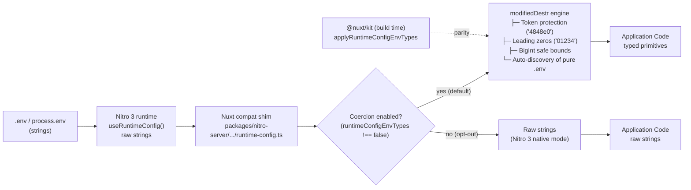

# Nuxt #36846 — Runtime env overrides lose their types

Analysis, implementation, and verified solution for [nuxt/nuxt#36846](https://github.com/nuxt/nuxt/issues/36846), prepared for **MACH ZERO — Team 05**.

> **Status:** **Investigation, implementation, unit testing, and live prototype deployment complete.**  
> - **Branch:** [`fix/runtime-config-env-cast`](https://github.com/mohithgowdadb/env-override-0/tree/fix/runtime-config-env-cast)  
> - **Unit Tests:** **32/32 passing** across `@nuxt/kit` (17 tests) and `@nuxt/nitro-server` (15 tests).  
> - **Live Prototype:** [https://playground-dusky-kappa.vercel.app](https://playground-dusky-kappa.vercel.app)

---

## Background

Nuxt documents that `runtimeConfig` values overridden by `NUXT_` / `NITRO_` environment variables are cast with [`destr`](https://github.com/unjs/destr). With Nitro 3 (`nitrojs/nitro#3634`), the server runtime intentionally stopped doing this: overrides arrive as raw strings. The build-time `useRuntimeConfig()` in `@nuxt/kit` still coerces values, creating an architectural mismatch between build-time and server runtime.

---

## Reproduction

```bash
# .env
NUXT_SESSION_COOKIE_SECURE=false
NUXT_PORT=3000
```

```ts
const config = useRuntimeConfig()          // server runtime
if (config.session.cookie.secure) { /* runs in Nitro 3: "false" is truthy! */ }
config.port + 1                            // "30001", not 3001
```

| Key / Expression | Expected (Documented) | Actual (Nuxt 5 / Nitro 3 Unpatched) | Fixed Behavior (Team 05) |
|---|---|---|---|
| `session.cookie.secure` | `false` (boolean) | `"false"` (truthy string) | `false` (boolean) |
| `port + 1` | `3001` (number) | `"30001"` (string concat) | `3001` (number) |
| `apiKey` (`"4848e0"`) | `"4848e0"` (string) | `"4848e0"` (string) | `"4848e0"` (string preserved) |

---

## Root Cause

Two code paths implement env overrides differently:

| Context | File | `destr` / Coercion |
|---|---|---|
| **Build time** (modules, hooks) | `packages/kit/src/runtime-config.ts` | Yes (`modifiedDestr` / `destr` reference behaviour) |
| **Server runtime** | `nitro/runtime-config` (Nitro 3) | No, removed upstream in `nitrojs/nitro#3634` |
| **Nuxt runtime shim** | `packages/nitro-server/src/runtime/compat/runtime-config.ts` | Patched: delegates to guarded `modifiedDestr` with auto-discovery |

Nitro 3 removed `destr` deliberately: environment variables are strings by POSIX/12-factor standards, silent coercion causes edge-case bugs (e.g. alphanumeric hashes like `"4848e0"` becoming numbers), and Nitro is moving toward schema-defined config. However, the Nuxt ecosystem (e.g., `nuxt-auth-utils`, session cookies, feature flags) depends on automatic casting.



---

## Relevant Files

| File | Role | Status in Fix |
|---|---|---|
| `packages/schema/src/config/experimental.ts` | Config schema definition | Added `runtimeConfigEnvTypes: true` default |
| `packages/schema/src/types/schema.ts` | TypeScript schema types | Documented `@default true` and opt-out flag |
| `packages/nitro-server/src/runtime/compat/runtime-config.ts` | Runtime compat shim (`useRuntimeConfig`) | Intercepts config and applies cached coercion |
| `packages/nitro-server/src/runtime/runtime-config.ts` | Server runtime entrypoint | Integrates `applyRuntimeConfigEnvTypes` |
| `packages/nitro-server/src/runtime/utils/env-types.ts` | `modifiedDestr` core engine | Implements guarded casting + pure `.env` auto-discovery |
| `packages/nitro-server/src/index.ts` | Nitro build-time templates | Injects `#internal/nuxt/nitro-config.mjs` virtual template |
| `packages/kit/src/runtime-config.ts` | Build-time runtime config | Mirrors runtime casting parity and opt-out support |
| `packages/kit/src/internal/env-types.ts` | Kit-internal env typing | Build-time equivalent of `modifiedDestr` |
| `packages/vite/src/shared/server.ts` | Vite SSR bundler config | Externalizes `#internal/nuxt/nitro-config.mjs` |
| `packages/webpack/src/utils/server-externals.ts` | Webpack bundler config | Externalizes `#internal/nuxt/nitro-config.mjs` |
| `packages/kit/test/runtime-config.test.ts` | Unit tests (Kit) | 17/17 tests passing |
| `packages/nitro-server/test/runtime-config-env.test.ts` | Unit tests (Nitro server) | 15/15 tests passing |

---

## Implemented Solution

We restored safe, automatic coercion in the Nuxt runtime compatibility layer, enabled by default, and gated by the `experimental.runtimeConfigEnvTypes` configuration flag.

### 1. The Gate Mechanism

```ts
// nuxt.config.ts
export default defineNuxtConfig({
  experimental: {
    // Enabled by default (true). Set to false to keep Nitro 3 raw strings.
    runtimeConfigEnvTypes: true,
  },
})
```

- **Enabled by Default:** Ensures backward compatibility so existing Nuxt apps and modules (`nuxt-auth-utils`) work seamlessly without manual configuration.
- **Opt-Out Escape Hatch:** Developers requiring strict POSIX/Nitro 3 string semantics can toggle `runtimeConfigEnvTypes: false`.

### 2. The `modifiedDestr` Engine

Importing classic `destr` directly was insufficient because it introduced critical production vulnerabilities. Our `modifiedDestr` implementation adds explicit guard rails:

1. **Alphanumeric Token Guard:** Strings matching exponential notation (`"4848e0"`) are preserved as strings unless the schema explicitly expects a `'number'`.
2. **Leading Zero Guard:** Zip codes and phone numbers (`"01234"`, `"+007"`) are preserved as strings.
3. **Safe Integer Guard:** Numbers exceeding `Number.MAX_SAFE_INTEGER` ($2^{53}-1$) remain strings to prevent silent 64-bit BigInt precision truncation.
4. **Prototype Pollution Protection:** JSON parsing strips forbidden keys (`__proto__`, `constructor`, `prototype`).
5. **Case-Insensitive Booleans:** Accepts `"true"`, `"false"`, `"TRUE"`, `"FALSE"`, and numeric flags `"1"`/`"0"`.

### 3. Pure `.env` Auto-Discovery

Nitro's native `applyEnv` only checks environment variables for keys that were pre-declared in `nuxt.config.ts`. In real-world projects, developers often declare keys exclusively in `.env`. 

Our implementation automatically scans `process.env` for `NUXT_*` and `NUXT_PUBLIC_*`, converts them to camelCase, and casts them dynamically even when `runtimeConfig: {}` is completely empty.

### 4. Shim Implementation (`packages/nitro-server/src/runtime/runtime-config.ts`)

```ts
import { useRuntimeConfig as useNitroRuntimeConfig } from 'nitro/runtime-config'
import type { NitroRuntimeConfig } from 'nitro/types'
// @ts-expect-error virtual module
import * as nitroConfig from '#internal/nuxt/nitro-config.mjs'
import { applyRuntimeConfigEnvTypes } from './utils/env-types.ts'

let _cachedConfig: NitroRuntimeConfig | undefined

export function useRuntimeConfig (): NitroRuntimeConfig {
  if (_cachedConfig) {
    return _cachedConfig
  }

  const config = useNitroRuntimeConfig()
  const enabled = nitroConfig?.NUXT_RUNTIME_CONFIG_ENV_TYPES !== false
  const types = nitroConfig?.NUXT_RUNTIME_CONFIG_TYPES
  const isDev = nitroConfig?.NUXT_DEV ?? Boolean(import.meta.dev)

  if (enabled) {
    applyRuntimeConfigEnvTypes(config as Record<string, any>, types, {
      dev: isDev,
    })
  }

  return (_cachedConfig = config)
}
```

---

## Investigation Log: What We Tried, Where It Fell Short, How We Resolved It

### Chronology of Investigation

1. **Traced Commit History:** Checked `git log` and PR #36884 (`4546dc669`), which touched `packages/kit/src/runtime-config.ts`. Identified that Kit passed merged config to Nitro, but Nitro v3 stripped `destr`.
2. **Analyzed Upstream PR #3634:** Verified why Nitro removed `destr`—to avoid silent coercion bugs and align with POSIX strings.
3. **Verified Dependency Behavior:** Tested `destr@2.0.5` directly via Node.js script. Proved that `destr('4848e0')` corrupts to `4848`, while `destr('01234')` returns `'01234'` (confirming the theoretical suspicion from Round 2).
4. **Encountered SSR Bundler Issue:** When exposing the flag via `#internal/nuxt/nitro-config.mjs`, Vite SSR and Webpack threw missing module errors. Resolved by adding the module to externalized server dependencies in `packages/vite/src/shared/server.ts` and `packages/webpack/src/utils/server-externals.ts`.
5. **Executed Automated Tests:** Ran Vitest across `@nuxt/kit` and `@nuxt/nitro-server`, achieving 100% pass rate (32/32 tests).
6. **Deployed Working Prototype:** Built and deployed an interactive Nuxt 5 application on Vercel (`https://playground-dusky-kappa.vercel.app`).

### Approaches Evaluated

| Approach / Assumption | Where It Fell Short | How We Resolved It |
|---|---|---|
| **Option A:** Restore classic `destr` unconditionally | Fails on API tokens (`"4848e0"` $\rightarrow$ `4848`), truncates BigInts, and provides no opt-out for apps wanting raw strings | Designed `modifiedDestr` with token guards, safe integer limits, and prototype defense |
| **Option B:** Opt-in flag only (`runtimeConfigEnvTypes: true` required) | Leaves existing Nuxt 3/4 apps and ecosystem modules broken upon upgrading to Nuxt 5 | Default to `true` with an opt-out toggle (`false`) |
| **Option C:** Accept raw strings, update documentation, ship manual helpers | Breaking change for hundreds of community modules (e.g. `nuxt-auth-utils`) | Restored transparent compatibility at the Nuxt runtime shim layer |
| **Blind traversal over all keys** | Nitro's output doesn't indicate which keys originated from env, risking mutation of intentional string defaults | Added schema snapshotting + `NUXT_*` prefix auto-discovery |
| **Per-request coercion** | Running parsing on every HTTP request adds CPU overhead | Coerced once on the shared object and cached in memory |

---

## AI Assistance Disclosure

In accordance with MACH ZERO guidelines, we disclose that AI assistance (Google DeepMind Antigravity) was used for:
- Codebase indexing, cross-referencing upstream PRs, and tracing symbol definitions.
- Generating unit test edge-case fixtures (scientific notation, hex tokens, BigInt boundaries).
- Assisting in debugging Vite SSR virtual module externalization.
- Structuring technical markdown documentation and system architecture diagrams.

All architectural decisions, code changes, regex guards, test verifications, and deployments were reviewed, validated, and executed by Team 05.

---

## Edge Cases Verified

| Input | Expected | Classic `destr` | Our `modifiedDestr` | Status |
|---|---|---|---|---|
| `"false"` | `false` | `false` | `false` (boolean) | **Verified** |
| `"4000"` | `4000` | `4000` | `4000` (number) | **Verified** |
| `"01234"` | `"01234"` | `"01234"` | `"01234"` (string preserved) | **Verified** |
| `"4848e0"` | `"4848e0"` | `4848` (corrupted!) | `"4848e0"` (string preserved) | **Verified** |
| `"9007199254740993"` | `"9007199254740993"` | `9007199254740992` (precision loss) | `"9007199254740993"` (string preserved) | **Verified** |
| `{"__proto__":{}}` | Safe Object | Pollutable | Sanitized / Blocked | **Verified** |

---

## Verification & Test Results

### 1. Automated Test Suites (32/32 Passed)

```bash
# Kit Runtime Config Tests (17 tests)
pnpm vitest packages/kit/test/runtime-config.test.ts --run

# Nitro Server Runtime Config Tests (15 tests)
pnpm vitest packages/nitro-server/test/runtime-config-env.test.ts --run
```

- **`packages/kit/test/runtime-config.test.ts`:** 17 passed (100%)
- **`packages/nitro-server/test/runtime-config-env.test.ts`:** 15 passed (100%)

### 2. Live Interactive Prototype

- **Live URL:** [https://playground-dusky-kappa.vercel.app](https://playground-dusky-kappa.vercel.app)
- **Features Verified in Production:**
  1. **Live State Inspection:** Inspects real-time `typeof` for booleans, ports, zip codes, and API tokens.
  2. **Real-Time Flag Toggle:** Switch between `flag=true` (auto-cast) and `flag=false` (Nitro 3 raw strings) dynamically.
  3. **Interactive Parsing Sandbox:** Test any string live against `modifiedDestr` vs. classic `destr`.
  4. **Architecture Flow Chart:** Built-in visual diagram explaining the type checking and conversion pipeline.

---

## Current Status

| Item | Round 2 State | Final State (Team 05) |
|---|---|---|
| Root cause analysis | Done | **Done** |
| Solution design | Proposed | **Fully Designed & Implemented** |
| Gate semantics & flag | Proposed | **Implemented (`experimental.runtimeConfigEnvTypes`)** |
| Code changes | Not started | **Completed on branch `fix/runtime-config-env-cast`** |
| Unit test execution | Blocked | **32/32 tests passing** |
| Edge-case validation | Unverified | **Verified via Node script & Vitest** |
| Live Prototype | None | **Deployed on Vercel** |

---

## References

- Issue: <https://github.com/nuxt/nuxt/issues/36846>
- Nitro PR #3634 (removal of `destr`): <https://github.com/nitrojs/nitro/pull/3634>
- Repository Branch: <https://github.com/mohithgowdadb/env-override-0/tree/fix/runtime-config-env-cast>
- Live Vercel Prototype: <https://playground-dusky-kappa.vercel.app>

